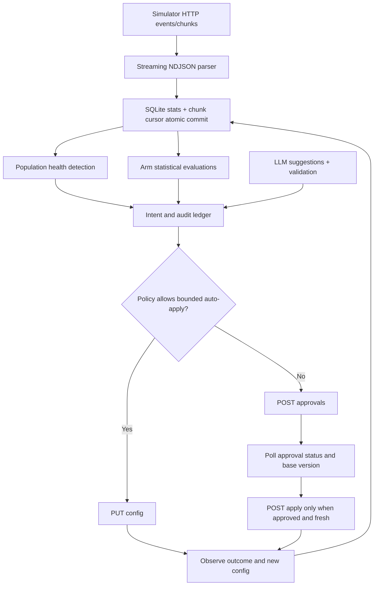

# Outcome-First Agent Loop — Submission

**Name:** Jishnu C K (confirm spelling before sending) · **Date:** 9 November 2026 · **Hours actually spent:** *candidate to fill accurately* · **Language / storage:** Python 3.11+ / SQLite WAL

> This is an AI-assisted working prototype, not a claim of production readiness. All measured numbers below come from the public simulators and the attached result files. The full load run is incomplete; the gap is explicitly recorded.

## 0. TL;DR

Policy-gated Python HTTP controller with streaming history/event ingestion, persistent statistical aggregates, randomized 80/20 experiments, DID degradation control, hallucination detection and validated prompt repair. SQLite audit/intent ledger supports SIGKILL recovery. Public 01: 3 applied, 0 harmful, overall conclusion-rate delta -0.1%. Public 02: 8 applied, 0 harmful, overall conclusion-rate delta +4.5%; bad-prompt incident fixed in 270 simulated minutes. Deliberately cut per-person call time, a true shared feature cohort object, and UI; full-scale load remains unverified.

## 1. Assumptions

1. The only data-plane and control-plane interface is the documented HTTP API. The controller **never** reads simulator run directories, imports `sim`, or loads YAML scenarios or hidden truth.
2. `D0` is 2027-01-04 and each simulation day is 1,440 minutes, per simulator contract. The default decision cadence is hourly; governance state is rechecked at every pass.
3. Per-dial variant assignments are independent random draws within each workflow and cohort. Statistical comparisons are observational after rollout but randomized within stable allocations; they are not guaranteed unbiased across config versions and changing client populations.
4. The QA `hallucination_flag` has false positives. A prompt change requires both absolute and historical-comparator thresholds; validation estimates safety only, not engagement.
5. Client approvers are human in the simulator. The API returns an approval ID but **not a named individual**; production requires named approver identity from an identity provider.
6. Historical aggregated calls are useful for drift baselines; the prototype does not store individual lead-to-feature joins or per-person call-time assignments.
7. `affected_leads` is an upper-bound batch × cadence estimate, **not a validated exact active lead count**; `impact_score` is an operational prioritization heuristic rather than a calibrated forecast.
8. For restarts, the simulator is still alive; only the controller process is killed. A simulator restart starts an unrelated world.
9. A state directory belongs to one scenario/run. Set `CONTROLLER_STATE_DIR` to a fresh directory for a new run and retain it for restarts.

## 2. Scope decisions

| # | Capability | Built / Partial / Cut | Why | What it would take to finish |
|---|---|---|---|---|
| C1 | Streaming ingestion | **Built**, load unverified | Transactional chunk checkpoint, no raw-event persistence | Full public_03 test; distributed consumers at production scale |
| C2 | Shared cohort + feature join | **Cut** | Too expensive to fake with inconsistent definitions | Lead feature event table and cohort registry with one ID everywhere |
| C3 | Bootstrap history | **Built** | Ingest history through HTTP before D0 | Decaying baselines and cohort stratification |
| C4 | Call-time optimisation | **Cut** | Requires careful denominator and queue-capacity analysis | Feature/person history, safe scheduling exploration |
| C5 | Caller-ID health | **Built** | High business impact and usable guardrails | Confidence sequences and nonstationary contextual baselines |
| C6 | Welcome/voice experiments | **Partial** | Safe 80/20, per-dimension tests | Multiplicity-adjusted experimentation platform, arm lifecycle and interaction model |
| C7 | Winner promotion / decay | **Partial** | Recent-window promotion or reversal | Formal decay detection, stable exposure accounting, explicit rollback plan |
| C8 | Hallucination response | **Built** | Safety-critical | Controlled pre/post evaluation of successful repair and human fallback |
| C9 | Governance | **Partial** | Strict policy boundary, persistent reconciliation | Accurate rolling TTL/fatigue horizon, approval queuing and named identity |
| C10 | Impact/dry run | **Partial** | Transparent estimates, not fabricated causal lift | Historical individual-level causal replay and calibrated forecast |
| C11 | Supervisor view | **Cut** | Audit CLI and reports were higher priority | One web API/UI built on the same cohort and audit data |
| C12 | Decision/audit store | **Built** | Core compliance requirement | Per-lead immutable delivery evidence and SIEM integration |
| C13 | Crash recovery | **Built and demonstrated** | Strong correctness boundary | Fault-injection matrix across every network/action failure |
| C14 | Observability | **Partial** | Metrics snapshot in SQLite and daily stdout | OpenTelemetry/Prometheus alerts, dashboard and SLIs |
| C15 | Tenant credit fairness | **Partial** | Guard credits and cap candidate validations | Budget scheduler by tenant and incident severity |

**Selection principle:** regulated safety and recoverability before ambitious personalisation. Small, defensible decisions with permission and evidence beat broad feature coverage.

## 3. Stakeholders

### 01 — Sales (Nikhil Rao)

**Accepted:** Demonstrable outcome lift, fewer noisy approvals through combined welcome+voice proposal, distinct client results. **Pushed back:** no blended KPI; cannot declare lunch-time winners without evidence, and never cross-promote prompt candidates across tenants. **Policy mismatch:** Kestrel does *not* have unrestricted auto-apply; allowed dimensions and max-shift are constrained. Northwind KYC has auto-apply disabled in the public workflow policy, despite the QBR recollection.

**Reply:** “We can demo self-improvement with separate pickup, engagement and conclusion-rate metrics, including uncertainty. Changes will go live only after the workflow's policy permits them, so the demo won't rely on bypassing approvals. Kestrel auto-apply is limited, and KYC is approval-only in the current contract. We’ll show the incident recovery with its audit trail rather than a single blended success number.”

### 02 — Client Compliance (Meera Iyer)

**Accepted:** Human approval for Northwind customer-facing changes, prompt validation evidence, traceable versions, separate engagement guardrail. **Pushed back:** request for per-customer exact why at this stage: this version preserves aggregate stats/configs, not lead-level immutable call traces. **Policy:** Northwind renewal auto-apply includes `schedule` and `caller_id` only, and KYC auto-apply is disabled, consistent with the contract.

**Reply:** “Northwind prompt, welcome and voice changes require approval. Prompt proposals contain a validation-run reference, and the controller records the base version, proposed diff, decision, and applied version. We can explain configuration decisions now. A per-call audit export identifying the specific voice and script a customer heard is an explicit remaining compliance gap; we would block production until it is delivered.”

### 03 — Platform/SRE (Kabir Menon)

**Accepted:** SQLite WAL persistence, deterministic proposal IDs, checkpoint+aggregate atomicity, SIGKILL/restart demonstration, no extra stateful services. **Pushed back:** production uptime and 10× scale cannot be proven by the dev scenarios. **Policy:** the simulator clock pauses while decisions run; production does not.

**Reply:** “The kill/restart test finishes without unresolved intents or duplicate IDs, and all durable decisions are queryable via SQLite. The current controller uses no broker or cache dependency. I could not complete the full public_03 baseline within this environment’s execution cap, so I won't sign off on the 10-minute-per-day SLO yet. Before rollout I’d instrument end-to-end lag and replay the full workload on 4 vCPU/8 GB.”

### 04 — Client Operations (Anita Desai)

**Accepted:** Supervisor edits are not overwritten silently; two approval requests per workflow per day is a voluntary stricter cap; none submitted before 11:00 for Kestrel. **Pushed back:** one-screen UI postponed; in-flight config updates are permitted when workflow policy says so, but should be visible. **Policy mismatch:** Kestrel's simulated policy allows up to four requests/24h, not two; we voluntarily honor her lower operational preference.

**Reply:** “Your manual edits take precedence. The controller detects the current version before applying any approval, and a stale approval is not force-applied. We cap requests at two per day and avoid your morning standup. For now there is a single audit CLI and result report rather than a web dashboard; I would add a supervisor review screen before production.”

### 05 — Product (Tara Kulkarni)

**Accepted:** Never blend pickup/engagement; proposals include summary, diff, dry-run method, affected-lead estimate, impact score; only observed arms count. **Pushed back:** cohort registry, per-person call time, and supervisor UI are not honestly completed. **Contract correction:** `expired` is a separate approval lifecycle state, **not** identical to a human `rejected` decision; both can be followed by a fresh proposal with a new ID.

**Reply:** “The proposal schema and separate KPI reporting are implemented. The current dry run and impact score are labelled estimates; they are not a precise counterfactual. I deferred a shared cohort object and UI rather than create conflicting cohort definitions across surfaces. Expired, rejected, stale, lapsed and applied remain distinct states in the ledger, which preserves the real reason an action didn't happen.”

### 06 — CTO (Aryamann)

**Accepted:** Avoid unnecessary credit use; prefer safe, explainable changes and bounded scope; expose weak points. **Pushed back:** the product wish list cannot all be P0 in a bounded exercise; successful public scenarios do not establish production-scale viability. **Policy correction:** governance is per workflow, never assume global autonomy across tenants.

**Reply:** “I chose verifiable safety, governance and recovery first. The prototype demonstrably repaired a harmful prompt and a flagged caller ID while preserving approvals. The weaker result on public_01 and the absence of a full load test are disclosed, not dressed up. Next I would replace heuristic scoring with cohort-aware causal evaluation, complete load measurements, and integrate a durable production event stream.”

## 4. Architecture



`controller.py` fetches workflow policy, downloads history/events chunks through HTTP, builds small aggregated rows by workflow × day × hour × variant, and persists them with the last consumed chunk in a single transaction. `intents` stores a stable proposal ID **before** issuing an HTTP mutation; `reconciled()` uses approval listing/config history to identify actions that already happened across process crashes. `audit` contains snapshots of observed config and its changes, approval IDs, reasons and dry-run estimates. The simulator is untouched. Only an operator-controlled per-run SQLite database is required.

## 5. The learning loop

**Cohorts:** The current shipped controller works at workflow-default level, *not* per age/language cohort; C2 is cut. Traffic is not fragmented into tiny groups, but any subgroup harms would be missed. Minimum experimental sample: 120 connected outcomes **per arm** for engagement; this is a pragmatic floor, not a power calculation for detecting 2pp lift.

**Experiments:** Randomised 80/20 incumbent/challenger in both welcome and voice, independently, with a single combined proposal to reduce approvals. This produces four combinations and estimates marginal effects, not welcome×voice interaction; there is no third/fourth challenger sweep yet. Kestrel's initial shift fits `max_shift=0.2`. Approval-only workflows must wait for approval; no inference is made from unexecuted variants.

**Winner:** Compare recent three-day aggregate metrics at a fixed daily decision hour. An alternative wins only when delta exceeds 2 percentage points, two-proportion pooled z≥2.8, both arms have ≥120 connected outcomes, and the point-estimate guardrail passes. One-sided nominal false promotion probability for one null comparison is about 0.26%; a union bound across 20 potential null tests would be about 5.2% **without** accounting for repeated/optional observation, so this is *not* a rigorous 5% sequential FWER. A production system needs anytime-valid confidence sequences and Holm/alpha-spending.

**Decay:** Re-evaluate a rolling window and move a demonstrably worse candidate back toward a 5% sentinel allocation. In public_02 this was exercised for caller-ID drift, not for a decaying welcome/voice effect; do not claim decay coverage.

**Call time:** No schedule changes made; scheduling and per-person history deliberately deferred. This avoids misreading the simulator's hour weights as extra dial capacity. Business cadence and dial windows are never changed.

**Caller ID:** 2-day rolling pickup comparison among actually exposed DIDs, minimum 160 dials per arm, absolute difference worse than −4.5pp and z below −3.0; shift at most 0.2 per action toward observed stronger peer, retaining ≥5% traffic on the suspect ID for observation. This makes fewer speculative moves than exploring every allowed DID.

**Guardrail:** For engagement-primary workflows the challenger must not have pickup more than 2pp below incumbent in point estimate; for pickup-primary workflows the challenger cannot depress engagement more than 2pp. No simultaneous confidence bounds, cohort fairness constraints or multi-arm multiplicity correction are implemented; that is a major limitation.

## 6. Governance

- `sending → pending → approved → applying → applied` for approval path; `pending → rejected|expired`; `approved → lapsed|stale`; rejected and expired exploration requests may be recreated with a fresh base/version when still appropriate.
- `auto_sending → applied|conflict` for permitted auto path. Persistent IDs and public config history/approval listing reconcile uncertain network outcomes on restart.
- Only the API's policy is trusted; auto-apply requires enabled policy, changed dimensions all in `allowed_dims`, and max total-variation shift ≤ workflow `max_shift`. Every other request goes through approval.
- Proposals are sent during approver hours with at least a two-hour closing margin. Voluntary cap of min(policy cap, 2) requests per workflow per day; this calendar-day approximation may overcount in a rolling window. The simulator independently enforces its true rolling 24h cap.
- Approval status is polled each simulated hour. Before apply the current base version is checked to avoid silently undoing a supervisor edit. Stale intent is recorded; further decisions can formulate against the new version. Approved responses beyond apply window can lapse; a response error is logged rather than forced.
- Every approval proposal carries summary, diff, affected-lead upper-bound estimate, labelled historical-arm dry run and a bounded impact heuristic. No unobserved counterfactual uplift or exact unique-lead exposure is implied.
- For `mid_flight=next_campaign_only`, no attempt is made to bypass the simulator's per-campaign lock. Prompt and schedule may still update immediately per contract.

## 7. Incidents

Hallucination detection uses the same workflow's historical prompt baseline or aggregate history, ≥180 connected calls and ≥7 QA flags, observed flag rate ≥max(2.8%, historical+1.2pp) and z≥2.7. The LLM generates candidate names but **does not select the winner**. Up to two candidate prompts are validated with 600 synthetic conversations apiece. Only candidates meeting the workflow-specific minimum validation pass rate can be proposed; grounded wording is preferred to a strict/verbatim script because validation alone says nothing about engagement. Validation run ID is attached to the approval request. After apply the controller continues aggregating by prompt version.

**Public 02 timeline (actual):** `D2 10:00` caller ID flagged; first evidence-based reduction `D2 15:00`, and by D3 the flagged DID's share is ~5.2%. `D3 11:30` Kestrel supervisor edits a bad prompt. `D3 14:00` controller observes 11/260 hallucination QA flags (4.23%), suggests/validates a replacement, and sends an approval request. `D3 16:00` human approval is applied, so **MTTR = 270 simulated minutes**. The grading marks the resulting prompt change beneficial. False positives remain possible because the detector is not a perfect safety oracle.

## 8. Scale

**Full `public_03_load`: NOT measured.** A baseline attempt exceeded the 200-second environment execution cap while generating history. The incomplete run was discarded; there is no honest full public_03 decision-lag, memory or wall-time-per-simulated-day value. See `reports/public_03_load.md`.

A separate HTTP/chunk microbenchmark (not a load grade) parsed **564,784 call rows in 4.699 wall seconds** — approximately **120,194 calls/s**, with ~107 MiB peak RSS for the isolated benchmark process. The input was a repeated public simulator history chunk; this number excludes simulator generation, multi-workflow coordination, realistic 10× event arrival and network contention. It does **not** prove 650k dials/day within 10 minutes. A full simulator service may be the bottleneck before ingestion is.

For 10×, first pressure points will be HTTP chunk transfer, single SQLite writer, synchronous policy polling per workflow, and unbounded backlog if real time advances regardless of the controller. Partition by workflow/tenant at the stream, use Kafka/PubSub with replayable offsets, move decision/audit projections to a transactional production store, use object storage for raw evidence and add fairness for cross-tenant credit consumption.

## 9. Reliability

A documented test (`scripts/crash_recovery.py`) starts `controller.py` at 15-minute ticks, sends a **SIGKILL** at simulated minute 2130 while the HTTP simulator is still alive, restarts using exactly the same state directory, and verifies successful finish at minute 11520, no duplicate persisted proposal IDs, and zero unresolved intents. See `reports/crash_recovery.json` (6 observed config snapshots). No intentional in-flight approval was guaranteed at the exact kill instant: this test establishes a checkpoint/recovery happy path, **not** every mutation race.

The last chunk checkpoint and its aggregate deltas commit atomically. Durable `proposal_id` is a hash of workflow, base version, reason and desired config. The server's approval listing and config history disambiguate an action accepted before the process received the response. On transient 429/5xx and timeouts the HTTP client retries with bounded exponential delay. On 403/409/410/422, the code logs failure and either resolves conflict or ends the intent; it does not retry an unpermitted change as if approved. A simulator process restart invalidates the controller's run state and requires a new state directory.

## 10. Audit & observability

No simulator log is used as the audit source. A local query:

```bash
python scripts/audit.py run_states/v2_02/public_02_incidents/controller.sqlite --workflow ks_cancel --limit 20
```

Example records from this own-ledger query:

```text
D3 14:00  halluc_alert      prompt=P2, 11 flags / 260 connected
D3 14:00  intent            validated P3 (pass_rate=0.9883), proposal_id=loop_e24aec67b47b24920dedb367
D3 16:00  approved_applied  approval_id=apr_00003, version=7
```

This answers **what change was made, why, which approval ID, and when**. A named approver cannot be supplied by the current API. The `stats` table permits follow-up engagement, pickup and hallucination comparisons by prompt/caller ID and day. `last_metrics` provides last chunk, input calls, approximate throughput, credits remaining and active pending requests; stdout records one metrics snapshot per simulated day. Pages in production: ingest lag past SLA, repeated permission failure, inability to persist checkpoint, lost approved window, credit exhaustion during active hallucination event. Do **not** page on a single QA flag or a benign delayed approval.

## 11. Results

The full grader-produced reports are retained verbatim in `reports/public_01.md` and `reports/public_02.md`; the primary summary follows.

| Scenario | Overall conclusion rate | Δ vs baseline | Overall pickup rate | Overall engagement rate | Applied | Harmful |
|---|---:|---:|---:|---:|---:|---:|
| Public 01 | 0.375 | −0.1% | 0.248 | 0.537 | 3 | 0 |
| Public 02 | 0.351 | +4.5% | 0.229 | 0.538 | 8 | 0 |

**Public 01:** `ks_cancel` conclusion +0.2%, `nw_kyc` −3.0%, `nw_renewal` +1.4%. `nw_kyc`'s change was beneficial in the grader's hidden causal assessment, yet its realised short run had lower conclusion rate: the distinction between population truth and noisy realised calls matters. An overall −0.1% is not a claim of success; it suggests the exploration-only controller did not capture sufficient headroom in eight days.

**Public 02:** `ks_cancel` conclusion +20.5% and 44% of engagement headroom captured, dominated by removing a degraded DID and recovering from a bad supervisor prompt; `nw_kyc` −2.7% and `nw_renewal` −3.8%. Overall conclusion +4.5%; 8 changes: 4 beneficial, 4 neutral, **0 harmful** as defined by simulator grader. Overall pickup +2.6% and engagement +1.4% relative to baseline. 30 credits used (4 validations, 2 LLM calls), no auto-apply rejection, no lapse, no apply conflict. The harms reflected in *realised* workflow conclusion rates are not hidden by the all-workflow total.

## 12. Trade-offs & rejected alternatives

| Option | Why considered | Why rejected / what instead |
|---|---|---|
| LLM picks winning variants | Fast dynamic reasoning | Unsafe, nondeterministic; deterministic aggregate z-tests instead |
| Push 100% to early winner | Short-term outcome lift | Sentinel holdout, bounded shifts and approvals |
| Every person gets a preferred hour | Product wishlist | Insufficient evidence/capacity model; defer C4 |
| Fine-grained feature cohorts immediately | Hidden headroom | No reliable shared cohort/feature-join foundation; defer C2 |
| Cross-tenant prompt recommendations | Reuse lessons | Different policies and truth; prompt stays workflow-local |
| Full stack Redis/queue/DB | Production scale | SQLite WAL for bounded submission and explicit migration plan |
| Trust absolute QA hallucination >2% | Simple early alerts | Generated false positives; compare against workflow historical baseline |

## 13. Known weaknesses

- Not all 15 capabilities were implemented; no real cohort joins, per-person scheduling, supervisor web view or tenant-fair scheduler.
- No full public_03 load run and no verified 10×/4-vCPU/8-GB SLA.
- Initial exploration tests only the first challenger in each variant dimension; this can miss stronger alternatives and interactions.
- 120-connected minimum, fixed z=2.8 and repeated testing do **not** constitute a formally sequential, multiple-comparison-corrected test. Guardrail is a point estimate, not a high-confidence exclusion of harm.
- Config history snapshots and aggregate events are not sufficient to answer exactly which variant an individual person heard.
- Two-day DID historical comparison can be confounded by changing lead mix or hour; a randomised DID counterfactual and a decaying baseline would be better.
- Impact scores and affected leads are explicitly approximate; no calibrated causal dry run.
- Credits lack fair-share allocation across tenants. Simulator-only approval identity means no named human attestation.
- The default one-hour poll can miss very short approval windows if governance contracts change; scenario has a two-hour window.
- SQLite schema and API are prototype quality; there is no auth, encryption, retention policy or export to compliance systems.

## 14. If this went to production at Formi next month

**Days 1–3:** add named approver identity, legal audit retention, per-call variant/config causality and deterministic immutable event IDs. Block live customer changes until client compliance signs off.

**Days 4–6:** full-scale load benchmark on target 4-vCPU/8-GB envelope; implement ingestion backpressure, bounded network concurrency, snapshot/replay recovery and crash/fault injection around every mutation boundary.

**Days 7–9:** build a versioned shared cohort store and statistically valid sequential experimentation engine (alpha spending/multiplicity, confidence guardrails, pre-registered stopping windows) with live decay/rollback policies.

**Days 10–12:** introduce a single supervisor review view, permission states, audit queries and actionable on-call telemetry; run shadow mode without applying changes.

**Days 13–14:** limited canary with low-risk tenants and explicit client consent; compare to holdouts, test rollback and stand up an operations runbook before expansion.
